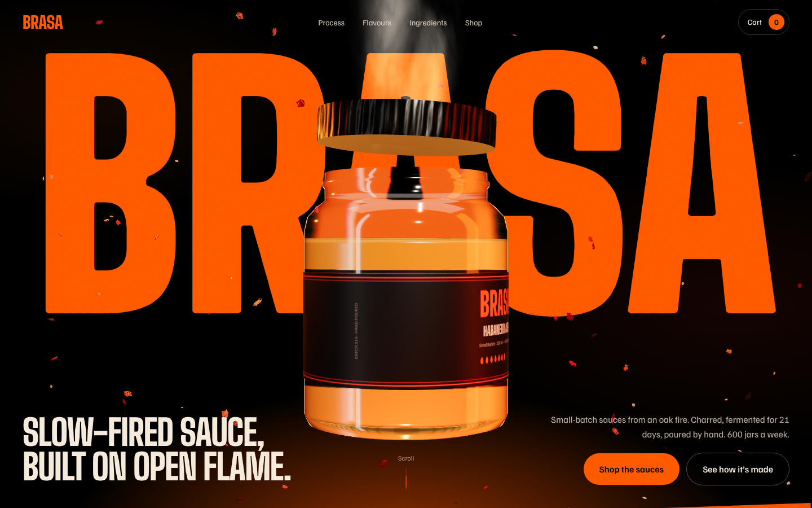

# Brasa — fire-roasted sauce landing page

A premium, scroll-driven storefront for a made-up gourmet sauce brand. Orange and black, oversized type, and a real-time 3D glass jar as the hero.



## Run it

```bash
cd brasa-sauce
npm install
npm run dev      # http://localhost:3000
npm run build && npm start   # production
```

## What's in it

- **3D jar** (`components/scene/`) built in code with React Three Fiber: a lathe-turned glass jar with real refraction (the giant "BRASA" word behind it bends through the glass), sauce that changes colour per flavour, a knurled metal lid, a printed wrap-around label, a steam shader, chilli-flake and seed particles, a pointer-following key light and a flickering fire light.
- **Scroll story** (`components/Director.tsx`): GSAP ScrollTrigger moves, spins, opens and seals the jar as you go through hero → process → flavours → ingredients → shop.
- **Sections**: pinned four-step process, one full-screen panel per flavour with heat meter, an ingredient list that opens on hover/tap, a product shelf with tilt-on-hover jars, a bundle offer, a newsletter form and a working cart drawer.
- **Micro-interactions** with Framer Motion: magnetic CTA, scroll-speed marquee, animated cart count, add-to-cart confirmation, quantity steppers.
- Smooth scrolling with Lenis, film grain and charred-glow backdrop in CSS.
- Respects `prefers-reduced-motion`, keyboard focus is visible, cart closes with Esc.

## Stack

Next.js 16 · React 19 · Tailwind CSS 4 · React Three Fiber + drei · GSAP ScrollTrigger · Framer Motion · Lenis

## Notes

- Checkout is a demo: it doesn't take payment.
- Fonts: Big Shoulders and Familjen Grotesk (Google Fonts, SIL Open Font License). `public/fonts/BigShoulders-Black.ttf` is used for the 3D text.
- Product data lives in `lib/products.ts`.
